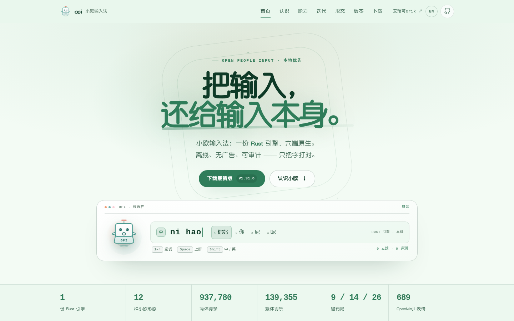

**[English](README.en.md) · [中文](README.md)**

# Open People Input (OPI)

Chinese name **小欧** (also the project pet), English name **opi**. A multi-platform input method that goes back to the basics.

> **Website**: [opi.erik.xyz](https://opi.erik.xyz) · **Downloads**: [GitHub Releases](https://github.com/erikwang2013/opi/releases) · **Install guides**: [docs/install/](docs/install/README.md)

[](https://opi.erik.xyz)

## Download & install

| Platform | Artifact | Install |
|---|---|---|
| Android | APK (full / normal / basic) | [Android guide](docs/install/android.md) |
| Windows | EXE (full / normal / basic) | [Windows guide](docs/install/windows.md) |
| Linux | DEB / RPM (full / normal / basic) | [Linux guide](docs/install/linux.md) |
| macOS | PKG (beta, unsigned) | [macOS](docs/install/macos.md) |
| iOS | IPA (beta, unsigned) | [iOS](docs/install/ios.md) |
| HarmonyOS | HAP (beta, unsigned) | [HarmonyOS](docs/install/harmony.md) |

Three package tiers:

- **Full**: speech engine, SenseVoice/Whisper models and all dictionaries included.
- **Normal**: all dictionaries included; speech engine and models download in Settings.
- **Basic**: app code plus the core pinyin dictionary; extended dictionaries, engine and models download in Settings.

On Linux, add OPI to the fcitx5 input-method group after installing; see [Linux guide §4](docs/install/linux.md).

## Highlights

- **One engine, six native clients**: Android, Windows, Linux, iOS, macOS, HarmonyOS.
- **Local first**: input, clipboard and speech stay on-device by default; no account, ads or telemetry.
- **Auditable privacy**: open dependencies and source; the About page opens the privacy policy in-app.
- **Cross-device transfer**: LAN discovery and encrypted sessions for files, folders, photos, text and clipboard; choose the peer when several devices are online.
- **On-device speech**: SenseVoice / Whisper recognition; audio is neither persisted nor uploaded.
- **Measured performance**: engine hot paths, first frame and candidate fetch have budgets and tests; see [performance notes](docs/performance.md).

## Verification boundary

What has been verified on each platform, and what still needs a real device, is recorded per chapter in [docs/install/README.md](docs/install/README.md). iOS / macOS / HarmonyOS are currently buildable beta artifacts; signing and real-device runs still need your own verification.

## Development

```bash
cargo test --locked -p engine-core -p engine-data -p opi-clip
./desktop/gradlew -p desktop test
./android/gradlew -p android testDebugUnitTest
```

Toolchains, packaging and per-platform build steps are in [docs/install/](docs/install/README.md); the website source lives in [`site/`](site/index.html).

## Licence

- **Code**: MIT, see [`LICENSE`](LICENSE).
- **Dictionary data**: licensed separately; per-item sources and licences are in [`data/raw/LICENSES.md`](data/raw/LICENSES.md).
- **Visual assets**: the Opi character, stickers, icons and documentation artwork are proprietary; commercial use requires written permission. See [`ASSETS-LICENSE.md`](ASSETS-LICENSE.md).

<!-- assets-license:start -->
## Visual Assets License

The Opi character, its stickers, sticker tables, app icons and documentation artwork are **proprietary assets, not open source**: commercial use requires written authorization; personal non-commercial use of unmodified official releases is allowed. Code stays MIT; OpenMoji (CC BY-SA 4.0) and kaomoji (MIT) keep their upstream licences. See [ASSETS-LICENSE.md](ASSETS-LICENSE.md).
<!-- assets-license:end -->
