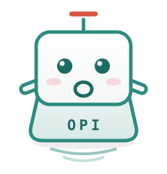
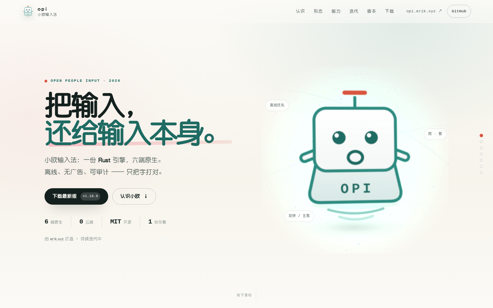
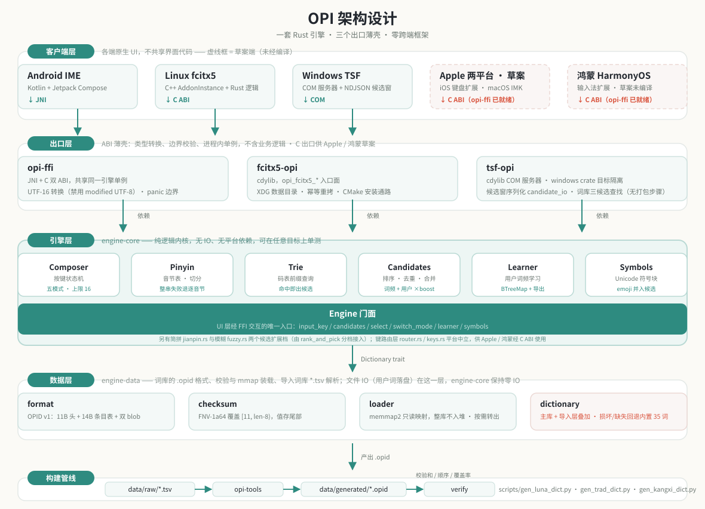
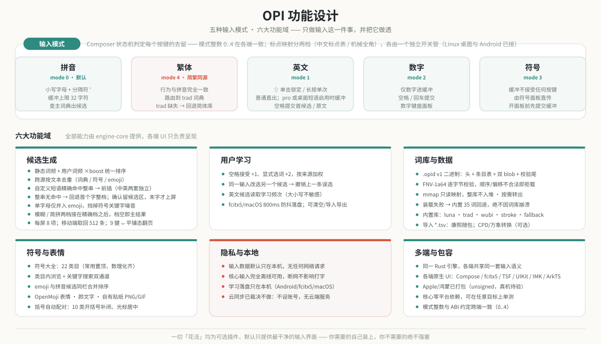
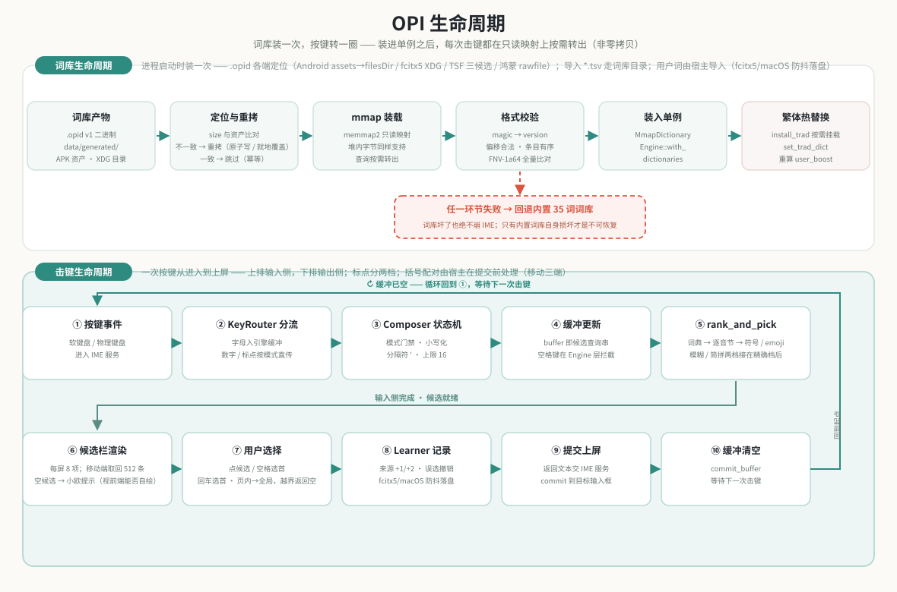

**[English](README.en.md) · [中文](README.md)**

# Open People Input (OPI)

中文名**小欧**（也是项目宠物名），英文名 **opi**；输入法以**小欧输入法**为准（opi 输入法也可）。

## 一款回归本质、人人可用的多端输入法

> **想装到自己机器上？** 各端安装教程在 **[`docs/install/`](docs/install/README.md)**
> （编译 / 打包 / 安装 / 使用，按平台分册）。
> **装完还有一步必做**：把 OPI **加进输入法组** —— 新装的输入法不会自动启用，不做这步
> 输入法列表里看得到它、打字什么都不会发生（fcitx5 插件重载已由安装脚本自动完成）。
> 逐条命令见 [`docs/install/linux.md`](docs/install/linux.md) 的 §4。

> **官网 / Website**：[https://opi.erik.xyz](https://opi.erik.xyz)（源码：[`site/index.html`](site/index.html)）—— 翻屏式项目介绍、3D 键帽环境与首访回忆时光轴、功能迭代、全量版本日志与各端下载（打赏二维码可原地点开，页脚含备案号）。
>
> **验证范围**：目前 **Android（模拟器）、Windows（真机，用户验收）与 Linux（容器 / 本机）** 有运行验证；**iOS / macOS / 鸿蒙** 已有客户端代码或可构建产物，但均未在真机验收，签名也未验证。
>




### 🐾 认识小欧

**小欧**是 OPI 的项目宠物 —— 一枚**键帽精灵**。

它长得就是键盘上的一颗键，因为输入法本该如此，不必是别的东西。

| 它身上 | 意思是 |
|---|---|
| **身体 = 键帽** | 输入的本体。不喧宾夺主，只做一件小事 |
| **嘴 = 字母 O** | Open —— 开源、开放、可审计 |
| **头顶天线 = 拼音声调 ˉ** | 拼音输入。朱砂色，全身上下唯一的暖色 |
| **侧壁刻字 = OPI** | 键帽的字符位，也正是项目名 |
| **底部涟漪** | 按键落下后只在本机扩散的余波 —— 不外传 |

形象见 [`docs/opi-pet.svg`](docs/opi-pet.svg)（纯手写 SVG，无外部依赖，可任意缩放）；十二种表情（笑 / 欢乐 / 哭 / 沮丧 / 惊恐 / 愤怒 / 撒娇 / 卖萌 / 讨好 / 敲打 / 捂脸 / 吐舌头）见 [`docs/opi-pet-forms.svg`](docs/opi-pet-forms.svg)；**动态 GIF 预览**见 [`docs/opi-pet-forms.gif`](docs/opi-pet-forms.gif)。它已经住进了代码里：

- **Android**：设置页的表情跟着引擎状态走（待命 / 等选 / 困惑 / 睡着 / 降级）；候选栏待命位、「无匹配」与符号搜索空结果三处空态；默认页顶栏空闲槽位的**十二形态宠物条**（笑 / 欢乐 / 哭 / 沮丧 / 惊恐 / 愤怒 / 撒娇 / 卖萌 / 讨好 / 敲打 / 捂脸 / 吐舌头，动态轮播 + 情绪色）；**启动图标**是自适应矢量前景 + 5 档 PNG 回退
- **Windows**：候选窗空态摊手；发行包（`.deb` / Windows EXE 安装器）的应用图标；**语言栏按钮**（TSF；只在语言栏开着时可见）
- **鸿蒙**：候选栏里的小欧，它自己就是「记不记词」的开关；应用/子类型图标
- **macOS**：输入源菜单图标（`macos/opi.tiff`）——CI 已真编译（unsigned pkg/app），真机未验证；图标只在 Mac 上才看得见
- **Linux（fcitx5）**：输入法条目在输入法列表与托盘里的图标
- **`opi-tools` 命令行**：编译与校验成功时打印字符版小欧（只用单宽度字符，CJK 终端不错位），`--version` 也带上它

两个 Compose 前端（Android 与 Windows 候选窗）共用同一份 [`shared/pet/OpiPet.kt`](shared/pet/OpiPet.kt)。各端 UI 不共享代码是这项目的原则，但宠物是一张图 —— 重复一份几何，两边迟早会长得不一样。

### 📖 项目缘起

**始于不满，成于热爱。**

在输入法几乎成为数字生活“基础设施”的今天，我们却越来越频繁地感到一种荒诞：

- 想输入一个生僻字，翻了三页候选词都找不到
- 明明关闭了所有隐私开关，输入法却依然“贴心”地推送着刚刚聊天提到的东西
- 词库越来越大，但你最常用的那个词永远排在最后
- 弹窗、皮肤商城、AI助手……功能多到让人眼花缭乱，却连“好好打字”这件事都没做好

我们并不是反感产品的迭代与进化。问题在于，**许多输入法在追求“大而全”的过程中，逐渐忘记了它最核心的使命——让输入这件事本身，变得简单、准确、高效。**

于是，**Open People Input** 诞生了。

这是一场“一气之下”的认真反抗，也是送给所有对现状感到失望的用户的一份礼物。

### 🎯 项目定位

**Open People Input** 是一款**开放、纯粹、跨端**的输入法，致力于为每一位用户提供**不被干扰、不被窥探、不被绑架**的输入体验。

它的名字就是它的全部信仰：

|  | 内涵 |
|---|---|
| **Open** | 引擎开源，词库开放，透明可审计。不玩黑箱，不藏后门，输入数据只属于你自己。 |
| **People** | 为人人而设计——无论你使用什么设备、使用什么语言、是否有特殊需求，都应该享有平等的输入权利。 |
| **Input** | 回归输入的本质。我们不喧宾夺主，只做一件小事，但要做到极致。 |

### ✨ 核心特性

> 本节只写**代码里已经跑得起来的东西**；尚未实现的愿景统一收到下方「🚧 未来规划」，逐条标注状态。此前的版本把两者混在一起、用陈述句写成现状，这里改了。

#### 1. 引擎一份，各端原生
**引擎只写一遍。** `engine-core` 是纯逻辑内核，无 IO、无平台依赖 —— **模块清单以 `crates/engine-core/src/lib.rs` 的 `pub mod` 声明为准**，惯常被点名的几块是 `Composer` 状态机 / `Pinyin` 音节切分 / `Trie` 码表 / `Candidates` 排序合并 / `Learner` 用户学习 / `Symbols` 符号表（**这是一份阅读导引，不是模块普查** —— 简拼 `jianpin`、模糊拼音 `fuzzy`、中文标点 `punctuation`、字节序 `bytes` 同在那一行 `pub mod` 里）。之上是唯一的 `Engine` 门面，UI 层只跟这个门面打交道。另有**平台中立的键路由层**（`router.rs` 的 `KeyRouter` + `keys.rs` 的键码表），供 Apple 与鸿蒙两个客户端经 C ABI 使用 —— 放这里是因为它是纯逻辑；它是**路由层而非引擎模块**，语义以既有的 fcitx5 / TSF 两轨为准，不自创。出口层是三个薄壳（`opi-ffi` 双 ABI · `fcitx5-opi` · `tsf-opi`），每个进程持一个引擎单例。

**六端都有客户端代码**：Android（Compose 原生 IME）、Linux（fcitx5 插件）、Windows（TSF 插件 + Compose Desktop 候选窗 —— 后者是**独立的 UI 代码库**，经命名管道与 TSF 通信）、iOS、macOS、鸿蒙。各端 UI 不共享代码，只共享输入语义；目前 Android（模拟器）、Windows（真机）与 Linux（容器 / 本机）有运行验证，iOS / macOS / 鸿蒙尚无真机证据（见下一段）。

**Apple 两平台与鸿蒙都已有可构建的端，但都还没有真机验证**——三个目录（[`ios/`](ios/)、[`macos/`](macos/)、[`harmony/`](harmony/)）里的 Swift 与 ArkTS 早已不是空骨架。**2026-10-15 订正**：Swift 两边（`ios/` · `macos/`）**已由 CI 真编译**（`apple.yml` 的 iOS / macOS job 里 `swiftc … -typecheck` + 真链接，2026-10-15 起全绿，同日抓出一处真错），iOS 产出宿主 App + unsigned IPA、macOS 产出 unsigned pkg/app；**2026-10-19 订正**：`harmony/` 已是完整 hvigor 工程，本机鸿蒙命令行工具链可跑 `hvigorw assembleHap`，已产出 unsigned HAP（含 `libopiime.so`；`luna.opid` / `stroke.opid` / `wubi86.opid` 由 rawfile 首次启动拷进沙箱，经 C ABI 以绝对路径装载），并已进入 1.26.x 的 unsigned 发布资产。⚠️ **三者拦路的原因不是同一个，别把它们绑成一句**：Apple 两端是**开发机不够**（本机无 macOS/Xcode/Apple SDK，编译发生在 CI 的 macOS runner 上）；鸿蒙是**签名与真机证据为零**（没有签名材料与设备，安装、输入法列表与运行行为都未验证）。**已就绪的还有平台中立的 C ABI**（`crates/opi-ffi`，见 `tests/cabi_test.rs`）——它不属于任何一端，且**已实测能为 Apple 与鸿蒙的多个目标编译**。三者的硬约束与现状见「未来规划」。

#### 2. 隐私优先，而且可以自己核对
- **默认本地化**：输入数据只留在本机。引擎层与出口层的依赖表里**没有 HTTP 客户端**，没有遥测，没有广告 SDK
- **网络只用于版本检测**：Android 仅声明 `INTERNET`（拉取 `https://opi.erik.xyz/version.json` 的版本号，不带输入/用户数据）；其余输入、候选、学习全在本机
- **iOS 的「完全访问」**：2026-10-20 起为自有贴纸写系统剪贴板而开启（`RequestsOpenAccess=true`，用户须在系统设置手动允许）；系统会显示隐私警告页。联网仅限设置页的版本检测（`version.json`），输入与用户词仍只写扩展容器
- **离线可用**：核心输入完全离线运行；`.opid` 词库走 `mmap` 只读映射，整库不读进堆（命中条目在查询时按需转出 —— `loader.rs` 的 `MmapDictionary::query` 每条命中 `.to_string()`、`candidates.rs` 的 `rank_and_pick` 再 `clone()` 一次，**不是零拷贝**）

（多端云同步**已裁决不做**（用户裁决 2026-09-28），见「未来规划」——**当前仓库里没有任何同步或加密代码**。）

#### 3. 词库是「活」的，也有门禁守着
- **多源整合（2026-10-11，用户裁决「主流开源词库去重整合」）**：rime-ice（雾凇）base+ext、rime-essay、chinese-xinhua 成语/歇后语、THUOCL 专业术语，加品牌/新词/注音/姓氏/流行语五张人工表，去重后并入 `luna.opid`（9.6 万条 → 90 万条量级、33MB；首字母查询靠前缀层 top-N 截断保住延迟，实测与取舍见 `data/raw/LICENSES.md`）。⚠️ 合并产物因此**整体按 GPL-3.0 分发**（数据层；源码仍 MIT）
- **简繁双库**：`luna.opid`（简体）+ `trad.opid`（繁体），按端随包分发（Windows 随包简体+繁体、macOS 需手工放繁体，见下方词库分发通路）；繁体库缺失/损坏自动回退简体库。**入口**：Android 上 26 键用模式轮转键、9/14/笔画三盘用底行的简繁键（`ImeScreen.kt`）/ iOS 用键盘上的模式轮转键并随包 `trad.opid`（`KeyboardViewController.swift`）；**fcitx5（Linux）2026-10-09 起有 `Ctrl+Shift+F`**（随包装 `trad.opid`，见 `docs/install/linux.md` §5.3）；**macOS 2026-10-20 起有 `Ctrl+Shift+F` 与输入法菜单入口**（`trad.opid` 需用户手工放进数据目录才生效）；**Windows 2026-10-28 起 `trad.opid` 随包并由 TSF 装载**（与 DLL 同目录，缺/坏回退简体）；**鸿蒙 `opi_load_trad` 已桥接且 `trad.opid` 随包**（真机繁体仍未验收）。引擎与数据侧的繁体能力本身是完整的。**2026-10-18**：`trad.opid` 新增 `trad_modern.tsv`（约 4.2 万现代常用词，OpenCC 词组级简→繁）与康熙差集 622 条，条目 96,429 → 139,355；`luna.opid` 也补入康熙差集 1,279 条（条目 937,780）
- **单字全覆盖门禁**：GB2312 全量单字逐一断言有候选（`trad_coverage` 集成测试，字数判据写在测试里）。改词库若撞坏覆盖度，CI 直接红
- **词库坏了绝不崩输入法**：装载策略各端统一 —— **坏路径一律返回 `Err`，不静默回退**（`engine-data/src/dictionary.rs` 的 `load_or_fallback` 注释写明此前的静默回退是有意删除的：UI 会误以为完整词库已加载）；只有**未提供路径**（含空串）时才用内置回退词库（`data/raw/fallback.tsv`，条数以该文件行数为准）。是否再从 `Err` 兜底由调用方决定：Android 的 `EngineLoader` 接住后用内置词库重试（`EngineLoader.kt` 的 `fallback()`），fcitx5 把 `Err` 上抛（`fcitx5-opi/src/lib.rs` 的装载调用点），TSF 在解析层逐候选回退、最差落到内置 35 词（`tsf-opi/src/dict_path.rs` 的 `load_dict`）
- **词库分发通路**：Android 走 assets → filesDir（`EngineLoader.kt`）、fcitx5 走 XDG 数据目录且由 CMake 安装（`fcitx5-opi/cpp/CMakeLists.txt`）、Windows 走 `OPI_DICT_PATH` 环境变量 → DLL 同目录 → `%LOCALAPPDATA%\opi` → 内置回退（`tsf-opi/src/dict_path.rs`）。⚠️ **Windows 的用户入口自 2026-10-20 起是 EXE 安装器 `opi-<版本>-setup.exe`**（Inno Setup，内含 jpackage app image 与 `tsf_opi.dll`，默认装到 `C:\Program Files\opi`；TSF 注册失败只记日志、不回滚）。**2026-10-20 起 `luna.opid` 随包**（放在 app image 的 `app\` 目录、与 `tsf_opi.dll` 同目录，连同三份许可文本；CI 断言安装后的词库 SHA-256），开箱即用即走完整词库；**2026-10-28 起 `trad.opid` 也随包**并由 `dict_path::load_trad` 同装（缺/坏回退简体，CI 同样核 SHA-256）
- **导入词库与康熙字典（2026-10-14 / 2026-10-16）**：四端同一份**导入词库契约** —— `*.tsv`（`词<TAB>拼音<TAB>频次`）放进词库目录即被装载、可启停（Android `filesDir/dicts` · 桌面窗/TSF `%LOCALAPPDATA%\opi\dicts` · fcitx5 `$XDG_DATA_HOME/opi/dicts`）。**康熙字典词库**（`shunshi-kangxi-core`，MIT，20794 字全读音）随包分发、各端**首启种子一次**（删过不复活）；数据链 `scripts/gen_kangxi_dict.py`，取读口径与边界见 `data/raw/LICENSES.md`。**2026-10-18 起**康熙里默认库还没有的 (字,读音) 也并进 `luna.opid`（1,279 条）与 `trad.opid`（622 条），因此即使导入词库被删/未导入、或走没有导入通道的端，康熙字仍能在输入时匹配
- **Linux 侧已能打成发行版包**：`scripts/build-packages.sh` + `scripts/nfpm.yaml` 把 `cmake --install` 的暂存树原样搬进 `.deb` / `.rpm`（两个 `.so`、两个 conf、`luna.opid` 与两份许可证文本 —— **包内清单用 `dpkg-deb -c` / `rpm -qlp` 现场核，别照抄这句**），`.github/workflows/packages.yml` **手动触发**（`gh workflow run packages.yml --ref <tag 或分支>`，或 Actions 页面 → Packages → Run workflow）；产物在该次 run 的 artifact `opi-packages` 里，**只有填了 tag 输入项才会附到 release 上**。**运行时门槛是 fcitx5 5.0**：声明在 `crates/fcitx5-opi/data/addon/opi_fcitx5.conf` 的 `[Addon/Dependencies]`（写高了 addon 整个不加载，用户拿到一个「选得到、一个字都不出」的输入法，日志里还没有 opi 的报错），CI 在 debian:12 容器里带阳性 / 现行值 / 阴性三臂对照守着它。⚠️ 这条打包通路**只到「产物打得出来、包内清单与暂存树对得上」为止** —— 没有任何门禁真的 `dpkg -i` / `rpm -i` 过它；CI 验的是**同一棵暂存树**（`cmake --install` + `cp`），不是包本身
- **词库共建**：源数据是纯文本 `data/raw/*.tsv`，提交 / 审核 / 合并走 PR。流程与**许可证要求**见 [`CONTRIBUTING.md`](CONTRIBUTING.md)

#### 4. 拒绝「功能膨胀」
- 引擎只做一件事：五模式（拼音 / 繁体 / 英文 / 数字 / 符号）的按键状态机 + 简拼 / 模糊拼音 + 候选排序 + 本地学习。没有皮肤商城，没有弹窗，没有 AI 助手
- **简拼**（纯缩写输入，`nh` → 你好、`zg` → 中国）：引擎侧**默认开、有独立开关**（`Engine::set_jianpin`，与模糊音同源；开关是 2026-10-08 补的）—— **三端都能关**：Android 设置页、Linux（fcitx5 附加组件配置 / 桌面设置窗写同一份 conf）、Windows（设置窗写 `settings.ini`，经控制面 `reload` 立即重读；输入法未运行时下次激活生效）。触发条件、展开规则与上限都在 `engine-core/src/jianpin.rs` 的头注释里，门禁是 `tests/jianpin_ranking.rs`
- **候选层：精确匹配不设上限，前缀层按词频截断**：`FETCH_LIMIT` 与 `Engine::select` 内部那道截断都已拆掉，三处同值（`engine-core/src/router.rs` · `fcitx5-opi/src/candidate.rs` · `tsf-opi/src/logic.rs`，且互相之间有等值断言）；**前缀扩展层**（打一半的输入）自 2026-10-11 起按静态词频取 top-N（26 键 9216 / 9·14 键 2048，`dictionary.rs` 的两个常量，缘由与实测见 [`docs/performance.md`](docs/performance.md)）。⚠️ **移动端仍受取回窗口限制**：Android 的 `fetchLimit` 自 2026-10-26 起为 512（可翻到「壹」等后排精确单字），仍小于桌面全量池 9216；macOS 自 2026-10-20 改走 `candidatesPage()` / `selectPage()`，iOS 与鸿蒙本来就走分页出口，从不由前端给 limit
- **表情与颜文字（2026-10-18，2026-10-19 动图）**：表情面板换成 OpenMoji 常用表情（689 条、9 类：笑脸/人物/动物/植物/食物/旅行/活动/物品/符号）；**「自有」是独立顶级子页**（不与 Emoji/笑脸同组），12 个小欧形态以**动画 GIF** 贴纸呈现（静态 PNG 兜底）——Android 点选经 `InputConnection.commitContent` 依次尝试 **PNG → GIF**（PNG 是宿主最认的格式，GIF 是动图加分项；剪贴板兜底同序；编辑器都不接受时回退**带「小欧·」前缀的可区分文本标签**，如 `[小欧·笑]`，不再插入 Unicode emoji），桌面/iOS/鸿蒙因宿主限制把 **PNG + GIF 两份**复制到剪贴板并提示粘贴（粘贴方自选；iOS 写剪贴板的唯一通道需要「完全访问」，`Info.plist` 自 2026-10-20 起 `RequestsOpenAccess=true`，用户须在系统设置手动允许）；新增 390 条颜文字（7 类）。贴纸源 `shared/pet/stickers/` 与 `shared/pet/stickers-gif/`、数据与许可见 [`data/raw/LICENSES.md`](data/raw/LICENSES.md)，生成器 `scripts/gen_emoji_kaomoji.py` / `scripts/gen_pet_stickers.py`
- **输入即得表情（2026-10-18，2026-10-19 内置）**：拼音/英文缓冲（≥2 字母）命中常用表情关键字时，把 emoji **追加在文本候选之后**（`data/raw/emoji_keywords.tsv` 295 条；`weixiao`→😊、`smile`→😄；不挤掉文本首候选、9/14 键数字缓冲本轮不匹配）。另提供 12 形态的**短码** `:opi_smile:` 等（`shared/pet/emoji-font/map.tsv` / `shortcodes.tsv`；短码仅 Slack/Mattermost 类客户端渲染）；普通输入框仍以原 GIF/PNG 贴纸插入、失败回退「小欧·」文本标签。PUA 彩色字体与「自有表情用字体字符」开关已于 2026-10-20 删除；「自有」分类由「表情中显示自有」开关控制（缺省隐藏）。映射表与短码是项目专有资产，见 [`ASSETS-LICENSE.md`](ASSETS-LICENSE.md)
- **逐字确认（2026-10-17 用户裁决）**：整串有词组精确匹配时词组在最前、选中一次上屏；无精确匹配（打一半的前缀扩展词不算）则先出第一个字的整档（所有读音的字），确认一个字后它**留在候选区**（拼音行显示「中guo」），依次确认到最后一段才**整串进输入框**；缓冲空时 ⌫ 回滚上一个已确认的字。语义在引擎（`Engine::pending_text` / `commit_buffer_after_select`），四端同一条路；门禁 `tests/segment_commit.rs`
- **9 键多字组合与完整拼音行（2026-10-23 用户报障）**：9 键按键串走数字空间 DP（`crates/engine-core/src/composition_scheme.rs`）—— 段 = 词库精确键、2–4 段、至少一个多音节段；`厌蠢症` / `样样通` 这类整词不在库但分段在库的词能组合出来（真库门禁 `crates/engine-data/tests/nine_composition_real.rs`，桌面 release 中位约 2ms，单次最多 24 次按键类查询）。拼音行不再用「·」补待编键，而是把未覆盖键按**键面首字母**补全（引擎 `display_buffer`）；移动三端横向滚动查看完整串、不省略
- **中英两套自定义短语（2026-10-24；2026-10-25 开关缺省改为关）**：设置里「中文」「英文」两套**完全独立**的表与开关（各上限 2000 条、精确字母匹配、命中排在候选最前；缺省关，开启即热加载，无需重启或重新导入）；中文只在拼音/繁体键盘生效，英文只在英文键盘生效；各自 10 条/页、总数、增删改、JSON/TSV/CSV/等号/空白导入与 JSON/TSV 导出。宿主文件 Android `filesDir/opi_custom_phrases[_en].json`、Linux/Windows `<数据目录>/opi/custom_phrases[_en].json`、macOS `~/Library/Application Support/opi/custom_phrases[_en].json`；引擎只持内存，启动/重载/换词库时由宿主回放（`engine-core/src/custom_phrases.rs`，双 ABI 各四个英文出口）
- **括号自动配对（2026-10-26，Android/iOS/鸿蒙）**：输入 10 类开括号自动补闭括号、光标停在中间；再打对应闭括号跳过；空配对按一次退格成对删除。英文/密码框与选区不参与；Windows/Linux 未接光标回移，macOS 2026-10-28 已接（IMK client + `doCommandBySelector`，未上机验证；共享约定见 `shared/brackets/README.md`）
- **学习来源加权与误选撤销（2026-10-26）**：空格接受首候选 +1，显式点选/数字/面板 +2；同一输入下改选另一个候选时，撤销上一次误选的学习；英文候选读取已学频次（大小写不敏感）；fcitx5/macOS 用户词 800ms 防抖落盘，损坏或 0 字节文件原样保留
- **可选外部词库（2026-10-26）**：提供 CustomPinyinDictionary（CC BY-SA 4.0）与 rime-wanxiang（CC BY 4.0）离线转换器、许可与各端加载文档，Release 另附 20 万条/8 MiB 以内的导入包；不随包捆绑，Android/macOS 走 `opi_import_dict` 上限，Linux/Windows 目录直载无此限制（`docs/external-dictionaries.md`）
- **移动端键盘改版（2026-10-24）**：9/14/26 键与五笔统一参考图版式 —— 9 键主区 3×3 右上角序号 1–9（分词格=1），字母弹层字号递减、末项是该格序号且默认选中，左列标点可竖滚且末格「自定义」打开常用符号选择器；14 键 `qw er ty ui op / as df gh jk l / ⇧ zx(~) cv(!) bn(@) m(?) ⌫` 与底行 `符 123 , 空格 。 中英 换行`，ZX/CV/BN/M 弹层 `[大写对, 符号, 小写对]` 默认符号；26 键字母上方符号提示、长按/上滑弹层 `[大写, 符号, 小写]` 默认符号（大写/数字/符号直提，小写进引擎匹配词库）；五笔同 26 键版式，第三行最左「拼」切拼音、空格键面「五笔」。9 键无匹时拼音行只显示读音或留空，**不再把按键数字（如 468）当拼音显示**（Android/iOS/鸿蒙同款修复）
- **两处「机制已备」的接线现状**：其一，**中文标点与全角是两个独立开关**（引擎侧 `chinese_punct` 与 `fullwidth` 各自独立，门禁 `tests/punctuation_switches.rs`；`set_chinese_punct` / `toggle_chinese_punct` 与双 ABI 出口都在）—— **桌面状态栏两平台都已接**（`。，`/`🌕` 按钮：Linux 走 `opi-ctl`、Windows 走本机控制面；设置窗「中文标点」与 fcitx5 附加组件配置都落到这两个开关，Windows TSF 从 `settings.ini` 读同组值并经控制面 `reload` 立即重读）；**Android 工具条月相按钮已撤**（2026-10-12 加、2026-10-13 用户裁决「移动端功能区不需要全角、半角切换功能」移除 —— 能力保留：全角仍随模式默认值自动生效，字母/数字的直传点宽化（`Engine::fullwidthize`）不动），**Apple / 鸿蒙仍无 UI 入口**（两端 `toggleFullwidth` 只有 JNI 冒烟表一个调用方）。**键位不在引擎层** —— `engine_punct.rs` 的注释只给桌面两轨**建议**了暂定的 `Ctrl+/`，未定稿、两轨都还没实现，理由与实测见该注释。其二，**学习落盘**（`engine-data/src/user_words.rs` 的原子写 / 读取助手）现已由 fcitx5 与 macOS 接入：fcitx5 写 `$XDG_DATA_HOME/opi/opi_user_words.json`，macOS 写 `~/Library/Application Support/opi/opi_user_words.json`，均 800ms 防抖；Android 仍走自己的 Kotlin `UserWordStore.kt`；Windows TSF、iOS、鸿蒙仍是内存态（重启即丢）
- 排序有一条反直觉的设计 —— **不能把 limit 下推到词典查询**（学过的低频词可能反超截断线外的词）。这类细节才是本项目较真的地方，见下方「功能设计」

### 🚧 未来规划

以下是项目的愿景与**已裁决不做**的方向；**多数目前没有对应代码**，个别只做了一部分（见状态列）。写在这里是为了把边界说清楚，不是承诺时间表：

| 方向 | 状态 | 现状核对 |
|---|---|---|
| **更多平台**：Web（含小程序） | 未开始 | 这里指 Web **输入法**；仓库现在有静态官网 [`site/`](site/index.html)，但它不是 Web 输入法，浏览器端 IME 仍未开始 |
| **鸿蒙 HarmonyOS** | **可构建（unsigned）**（`harmony/`）| 完整 hvigor 工程（`build-profile.json5` / `hvigorfile.ts` / 模块配置与构建脚本齐备），本机鸿蒙命令行工具链 + SDK 可跑 `hvigorw assembleHap`；已产出 unsigned HAP（含 `libopiime.so`；`luna` / `stroke` / `wubi86` 由 rawfile 首启拷进沙箱），工具条 / 皮肤 / 键盘模式 / 符号页 / 生僻字已对齐 Android，CI 为自托管 `harmony.yml`。**签名、安装、真机输入法列表与上述新面板均未上机验证**；Rust 侧 C ABI 已能为鸿蒙目标编译。 |
| **Apple 两平台**：iOS · macOS | **CI 已编译 + unsigned 产物**（`ios/` · `macos/`）| `apple.yml` 在 macOS runner 上真编译 Swift；iOS 产出宿主 App + unsigned IPA（`Payload/Opi.app` + 键盘 `.appex`，键盘已补顶部槽位 / 工具条 / 皮肤 / 键盘模式 / 关于，自有贴纸经剪贴板且已开完全访问），macOS 产出 unsigned pkg/app（已补符号面板 / 输入法菜单 / 设置窗 / 候选分页）。**签名、公证、真机运行与输入法启用仍未验证**；C ABI 对 Apple 三个目标的 `cargo check` 通过，静态库导出符号已核对。 |
| **多端云同步 / 端到端加密** | **不做**（用户裁决 2026-09-28） | 无加密库、无 HTTP 客户端：跨 `crates/` `android/` `desktop/` 的 `*.rs` / `*.toml` / `*.kt` 里，`reqwest` / `ureq` / `hyper` / `openssl` / `rustls` / `chacha` / `argon2` / `aes-gcm` / `https://` 逐个零命中。带 `sync` 的命中全是 Rust 同步原语与 TSF 标志（`std::sync`、`TF_ES_SYNC`、`trad_assets_in_sync`），与云同步无关。**注**：学习词库导出 JSON 里确有 `version` 字段，但那是**导出格式**的版本协商（`learner.rs` 的 `import_json` 拒收 `version != 1`），与云同步无关 |
| **更多输入方案**：双拼 · 五笔 · 仓颉 · 注音 · 自定义输入规则 | 双拼（2026-10-13，六套布局）与五笔（2026-10-14，86/98）已落地；其余待做 | `Mode` 的成员仍是拼音 / 繁体 / 英文 / 数字 / 符号（`composer.rs`）；**按键布局**另有独立轴 `Scheme`（`scheme.rs`：全键盘 / 拼音9键 / 拼音14键 / 笔画 / 双拼 / 五笔 —— 匹配走按键类展开）；双拼与五笔在 Android / 桌面 / fcitx5 / TSF 均已接线（iOS / 鸿蒙仍是草案，见各自 README）；仓颉 / 注音 / 自定义规则仍未做 |
| **英文联想** | **已接线（2026-10-18；2026-10-19 默认普通、pro 才匹配）** | **普通模式字母直出**；`pro` 专业模式才前缀匹配 `data/raw/en_words.tsv`（10000 条常用词，Google Books Ngrams v3，CC-BY 3.0；**不是牛津原版** —— OUP 数据本仓无授权，换数据只需替换 TSV）。候选按词频降序；单字母缓冲时**输入原文排首位**（保留大小写、与词条去重）；空格提交首候选、无匹配提交原文；四端共用同一引擎语义，门禁 `tests/english_words.rs` |
| **无障碍**：读屏软件 | 部分（仅 Android） | Android 键盘已接基础读屏语义：候选变化自动播报（`liveRegion`）、每个按键有可读名称（不再读字形「⇧」「⌫」）、⇧ 的锁定 / 单次大写状态可读。**其余平台（Windows / Linux / iOS）未接入** |
| **语音输入 · 扫描输入** | 未开始 | 零命中 |
| **少数民族语言与方言**：藏文 · 维文 · 蒙文 · 粤语 · 吴语 | 未开始 | 零命中 |
| **插件化**：所有「花活」均为可选插件 | 未开始 | 无插件注册表、无插件接口、无动态加载 —— 当前也还没有需要插件化的「花活」 |

### 🛠 技术路线

| 层级 | 方案 |
|---|---|
| **核心引擎** | 纯 Rust 实现，多 crate workspace（`engine-core` / `engine-data` / `opi-tools`）；其中 **`engine-core` 无 IO、无平台依赖**，`engine-data` 负责文件映射与字节解析，`opi-tools` 是编译 CLI |
| **出口层** | `opi-ffi` 双 ABI（JNI + C）· `fcitx5-opi`（cdylib）· `tsf-opi`（cdylib COM 服务器），均以进程内单例持引擎 |
| **客户端 UI** | 各端原生，不引入跨端框架：Android 为 Jetpack Compose；Linux 为 C++ AddonInstance 调 Rust 逻辑；Windows 为 TSF COM + Compose Desktop 候选窗（命名管道 NDJSON 通信）|
| **平台接入** | Android (InputMethodService)、Linux (fcitx5)、Windows (TSF，已真机验收安装 / 打字 / 候选窗 / 中英文 / 状态栏)、iOS / macOS（CI 真编译 + unsigned 产物）、鸿蒙（完整 hvigor 工程 + unsigned HAP）；Apple / 鸿蒙的真机运行与签名仍未验证 |
| **数据同步** | **不做**（用户裁决 2026-09-28）：原计划为端到端加密 + 自托管服务支持；现决定**不提供云同步、不设账号体系**，用户数据只在本机 |
| **版本** | 单一版本源：根 `Cargo.toml` 的 `[workspace.package] version`，全部 workspace 成员（清单见同文件 `members`）共用；Android `versionName` 与 desktop `packageVersion` 向它对齐，发布 tag 取同一号 |
| **MSRV** | **1.88**，写在根 `Cargo.toml` 的 `[workspace.package] rust-version`（下界的来源与实测见该文件注释）。⚠️ 这句是**声明**，光有它两个方向都漏（真用了更新的语法而声明没跟上 / 声明被下调）—— 执行点是 CI 的 `msrv` job：它**从那个键推导**工具链，跑 `cargo check --workspace --all-targets --locked` |

### 🧭 架构设计



**五层，依赖只向下走。** 越往下越稳定，越往上越接近用户：

- **客户端层** —— 各端原生 UI。各端之间不共享界面代码，只共享输入语义。
- **出口层** —— ABI 薄壳，只做类型转换、边界校验、panic 隔离。每个进程持一个引擎单例，例如 Android 的设置页与输入法共享同一个 Rust 单例，所以设置页里改动学习开关，输入法里立刻生效。
- **引擎层** —— `engine-core`，**纯逻辑，无 IO、无平台依赖**。这是整个项目的心脏，也是最容易测的一层：`Composer` 状态机 / `Pinyin` 音节切分 / `Trie` 码表 / `Candidates` 排序合并 / `Learner` 用户学习 / `Symbols` 符号表，**完整模块清单以 `src/lib.rs` 的 `pub mod` 为准**；之上是唯一的 `Engine` 门面，UI 层只跟这个门面打交道。同层还有**平台中立的键路由**（`router.rs` / `keys.rs`），供 Apple 与鸿蒙经 C ABI 使用 —— 它是路由层而非引擎模块，语义以既有两轨为准。
- **数据层** —— `.opid` 二进制词库：定长头 + 定长条目表 + 双 blob + FNV-1a64 校验尾（各段长度以 `engine-data/src/format.rs` 的 `HEADER_LEN` / `ENTRY_LEN` 等常量为准，别抄数字）。装载走 `mmap` 只读映射，**整库不读进堆**；查询时每条命中的词都要转出一次 `String`（见 `loader.rs` 的 `MmapDictionary::query`），不是零拷贝。
- **构建管线** —— `data/raw` 的 TSV 源数据经 `opi-tools` 编译成 `.opid`，再经 `verify` 做校验和 / 顺序两道校验，并由 `trad_coverage` 测试守住 GB2312 单字全覆盖，才入库。

> **关键不变式：词库坏了绝不崩输入法。** 坏路径**不静默回退**（`engine-data/src/dictionary.rs` 的 `load_or_fallback` 注释有意如此），由调用方接住：Android 用内置回退词库重试，fcitx5 把 `Err` 上抛，TSF 在解析层逐候选回退到内置词库 —— 只有内置词库自身损坏才是不可恢复的。

### 🧩 功能设计



**五种输入模式**由 `Composer` 状态机按模式整数（即 `Mode` 枚举的判别值，**具体取值以 `composer.rs` 的 `enum Mode` 为准**；三个跨语言出口 JNI / C ABI / fcitx5 取值一致）判定每个按键的去留：

| 模式 | 行为 |
|---|---|
| **拼音**（默认） | 小写字母与分隔符 `'` 进缓冲（缓冲上限见 `composer.rs` 的 `MAX_BUFFER`），查主词典出候选 |
| **繁体** | 行为与拼音完全一致，只是路由到 `trad` 词典；trad 缺失则回退简体库 |
| **英文** | `⇧` 单击锁定大写（再点取消）、长按单次大写；底行 `pro` 切换普通/专业：**普通（默认）字母直出、不做单词匹配**（桌面两轨在英文自定义短语开启且表非空时临时改为缓冲以便匹配短语），专业才进引擎做前缀联想（单字母首候选是输入原文，保留大小写）；**离开英文去中文会自动关闭 pro**（2026-10-20 用户裁决）；仅「携带缓冲」直传；英文键盘顶部有 0-9 数字行（数字直提） |
| **数字** | 仅数字进缓冲，空格 / 回车提交 |
| **符号** | 缓冲不接受任何按键，由符号面板直传；开面板前先提交 pending 拼音，不留残影 |

**六大功能域**里最值得一提的是候选排序。它有一个反直觉的设计：**不能把 limit 下推到词典查询**。因为学过的低频词可能反超截断线外的词，所以必须全量收集、统一排序、再去重截断。排序分是

```
score = 静态词频 + 用户词频 × boost
```

其中 `boost` 按词典最大词频**动态缩放**（`engine.rs` 的 `USER_BOOST.max(max_freq × 2)`，常量与算式以代码为准），而不是写死一个常数 —— 早期只写死常量时，在 luna 百万级词频下选一次「我」仍会输给静态词「倭」。动态缩放保证了「选一次就压过全部静态词」这个体验。

### 🔄 生命周期



两条独立的生命线，只有一个交点 —— **装进进程单例**。

**词库生命周期**在进程启动时跑一次：定位（Android 走 assets→filesDir，fcitx5 走 XDG 数据目录，Windows 依次试 `OPI_DICT_PATH` → DLL 同目录 → `%LOCALAPPDATA%\opi` → 内置回退，见 `tsf-opi/src/dict_path.rs`）→ 比对 size 决定是否重拷（幂等，防陈旧词库）→ `mmap` 映射 → 校验 → 装入单例。之后 `install_trad` 可以随时热替换繁体词典，且不影响简体模式。**用户词**在启动时由宿主导入：fcitx5/macOS 读 `opi_user_words.json`，选词后 800ms 防抖写回；Android 走自己的 Kotlin store。

**击键生命周期**每次按键跑一圈，十个步骤：① 按键事件 → ② KeyRouter 分流 → ③ `Composer` 状态机 → ④ 缓冲更新 → ⑤ `rank_and_pick` 排序 → ⑥ 候选栏渲染 → ⑦ 用户选择 → ⑧ 学习记录 → ⑨ 提交上屏 → ⑩ 缓冲清空。关键分支在第 ② 步：**缓冲为空时按键根本不进引擎**（英文/数字模式直传），这是输入法「不卡」的关键 —— 引擎只在真正需要组合的时候才被唤醒。移动端候选栏一次取回 512 条（9 键左列读数仍截 64），括号配对由宿主在提交前处理（Android/iOS/鸿蒙；macOS 2026-10-28 起）。

装载之后，每次击键都在只读映射上遍历、命中条目按需转出 —— 整库不进城，但**不是零拷贝**。

### 🏗 构建与测试

```bash
cargo test --workspace                   # 单元 + 集成 + 属性测试（含 fcitx5 / TSF 两轨）
cargo clippy --workspace --all-targets -- -D warnings   # 门禁：零警告
cd android && ./gradlew testDebugUnitTest   # Android 单测（引擎 FFI + IME 状态机 + 键盘路由 + 宠物）
cd android && ./gradlew assembleDebug       # 构建 debug APK（cargokit 编译 opi-ffi 三 ABI .so）
cargo build --release -p fcitx5_opi         # Linux 插件：只编 Rust cdylib
cmake -S crates/fcitx5-opi/cpp -B build-fcitx5 -DCMAKE_BUILD_TYPE=Release   # 完整通路（含 C++ 胶水，需 fcitx5-dev）
cmake --build build-fcitx5 && sudo cmake --install build-fcitx5             # 安装落点由 opi_locate_check 探针与 CI 守着
scripts/build-packages.sh                   # 打 .deb / .rpm（需 nfpm；落点取自上面的 cmake --install，产物在 dist/）
cargo check --workspace --all-targets --locked   # MSRV 那一遍 —— 在 Cargo.toml 声明的工具链上跑（CI 的 msrv job 同一条）
cd desktop && ./gradlew package             # Windows 候选窗（Compose Desktop）
./target/debug/opi-tools --version          # 版本号 + 小欧
```

> **`assembleDebug` 需要机器上有 `dart`**：cargokit 的构建工具是用 Dart 写的，缺了会在
> `cargokitCargoBuildOpi_ffiDebug` 任务上报 `dart: command not found`（退出码 127）。
> 只跑单测不需要它 —— `testDebugUnitTest` 走纯 JVM 假实现，不依赖 `.so`。

> **fcitx5 插件要求 C++20**：`crates/fcitx5-opi/cpp/CMakeLists.txt` 的 `CXX_STANDARD` 钉在 20 ——
> 较新的 fcitx5 头里用到了 C++20 的 `std::span` / `std::ranges`，钉回 17 会在新发行版上报
> **硬错误**（与 `-Werror` 无关），而两个老版本的头在 C++20 下照样零警告零错误。
> 分界在哪一版、两边各在什么版本上实测过，都写在该文件的头注释里；**别照抄这里的说法去改那个值**。

> **上面这些命令的落点是「已经编出来 / 打成包了」，还不是「装上了」。** 装机步骤、以及
> **装完之后那一步必做的动作**（把 OPI 加进输入法组；fcitx5 重载已自动），见
> [`docs/install/`](docs/install/README.md)。

### 📁 项目结构

```
crates/                        # Rust 工作区（crate 清单以根 Cargo.toml 的 members 为准）
  engine-core/                 # 纯逻辑内核：无 IO、无平台依赖
    src/                       #   模块清单以 src/lib.rs 的 pub mod 为准：
                               #   composer · pinyin · trie · dictionary · candidates ·
                               #   learner · symbols · engine，另有 jianpin（简拼）·
                               #   fuzzy（模糊拼音）· punctuation · keys · router · bytes
    tests/                     #   集成 / 属性 / 不变式三类，例如 engine_integration · proptests ·
                               #   ranking_invariants · router_invariants · trad_mode · symbol_coverage ·
                               #   jianpin_ranking · punctuation_switches · select_index_bounds
                               #   （**这是导引不是普查** —— 完整清单见 tests/ 目录）
  engine-data/                 # .opid 二进制词库：格式、FNV-1a64 校验、mmap 装载、损坏回退
    src/user_words.rs          #   用户词落盘（原子写）—— 文件 IO 归本 crate，engine-core 保持零 IO
  opi-tools/                   # 词库编译 CLI：tsv / dict.yaml → .opid，含 verify 子命令
  opi-ffi/                     # 双 ABI 出口：JNI（Android）+ C（Apple / 鸿蒙）
  fcitx5-opi/                  # Linux fcitx5 插件：Rust 逻辑（cdylib）+ cpp/ AddonInstance 胶水
    cpp/CMakeLists.txt         #   **唯一的编译 + 安装通路**，落点由 opi_locate_check 探针与 CI 守着
  tsf-opi/                     # Windows TSF 插件：Rust 逻辑 + COM 服务器 + 候选窗线协议
    src/dict_path.rs           #   词库查找顺序：环境变量 → DLL 同目录 → %LOCALAPPDATA% → 内置回退
    src/settings.rs            #   属性设置读侧（%LOCALAPPDATA%\opi\settings.ini，键名与设置窗逐字对应；控制面 reload 立即重读）
    src/ctl.rs                 #   本机控制面：状态 / 动作 / 搜索 / 上屏 / reload（\\.\pipe\opi-control-v2）
android/                       # Android IME（Kotlin + Jetpack Compose）
  app/                         #   IME 服务 · 键盘 / 候选栏 / 面板 · 设置页（含用户词导入导出）· 宠物组件
    src/main/assets/           #   luna.opid（简体）· trad.opid（繁体）· stroke.opid（笔画）· rare_index.tsv（部首索引）
    src/main/res/              #   自适应启动图标（VectorDrawable，含小欧）
  rust_builder/                #   cargokit 独立版：编译 crates/opi-ffi → 三 ABI .so
  jni_smoke/                   #   JNI 连通性冒烟测试
desktop/                       # Windows 候选窗 / 状态栏 / 设置窗（Compose Desktop / JVM，命名管道 NDJSON；关于页含项目与博客地址）
site/                          # 静态官网（翻屏 / 响应式 / three.js；见 site/README.md）
ios/                           # iOS 键盘扩展 —— CI 真编译；宿主 App + unsigned IPA 已产出，真机未验证（见目录内 README）
macos/                         # macOS 输入法（InputMethodKit）—— CI 已真编译；符号面板 / 输入法菜单 / 设置窗 / 候选分页；unsigned pkg/app，真机未验证
harmony/                       # 鸿蒙输入法（ArkTS + N-API）—— 完整 hvigor 工程，已产出 unsigned HAP（内含 libopiime.so）
                               #   词库从 rawfile 复制到沙箱；签名 / 安装 / 真机输入法列表仍未验证；构建用自托管 harmony.yml
shared/                        # 跨端共享的 Kotlin 源码
  pet/OpiPet.kt                #   项目宠物「小欧」的 Compose 绘制（Android 与 desktop 共用一份）
data/                          # 词库数据
  raw/                         #   源数据 TSV + LICENSES.md（逐条记录来源、许可证与上游 pin）：
                               #   symbols.tsv · symbol_blocks.tsv · trad_hanzi.tsv ·
                               #   trad_phrases.tsv · en_words.tsv · fallback.tsv
  generated/                   #   编译产物：fallback.opid · trad.opid 入库；
                               #   luna.opid 未入库（本地重编产物，入库副本在 android assets）
docs/                          # 宠物、图与设计文档
  install/                     #   各端安装教程（android / linux / windows / ios / macos / harmony）
  opi-pet.svg                  #   项目宠物「小欧」
  opi-pet-forms.svg            #   十二种表情（笑 / 欢乐 / 哭 / 沮丧 / 惊恐 / 愤怒 / 撒娇 / 卖萌 / 讨好 / 敲打 / 捂脸 / 吐舌头）
  social-preview.svg · .en.svg #   中英双语社交预览图（同名 .png 供 GitHub Settings → Social preview 上传）
  diagrams/                    #   架构设计 · 功能设计 · 生命周期
  superpowers/                 #   specs（设计规格）+ plans（实施计划）
  release-claim-corrections.md #   发布声明订正（tag 注释推出去改不了，实测到的正确说法落这里）
  weixinpay.png · alipay.png   #   赞赏码（页脚引用）
scripts/                       # 词库/表情生成：gen_luna_dict.py · gen_trad_dict.py · gen_trad_modern.py · gen_kangxi_extra.py · gen_symbols.py · gen_emoji_kaomoji.py · gen_pet_stickers.py · gen_emoji_keywords.py · gen_pet_emoji_table.py
                               #   （+ symbol_keywords.py 手写关键字表）· gen_en_dict.py · hanzi_freq.py · prepare_harmony_dicts.sh（鸿蒙 rawfile 词库预置）
                               # 发行版打包：build-packages.sh（.deb / .rpm）+ nfpm.yaml
                               #   （nfpm.yaml 只负责把暂存树搬进包，**落点不在这里声明**）
.github/workflows/ci.yml       # CI：rust（fmt / cargo test / clippy / C 消费者 + JNI 冒烟 /
                               #   TSF Windows 目标 / Apple 目标）· msrv（按 rust-version 推导工具链真编）·
                               #   android · fcitx5（C++ 编译 + 安装落点 + debian:12 容器里带三臂对照真加载）
                               #   ⚠️ job 与步骤的完整清单以该文件为准，别照抄这一行
.github/workflows/packages.yml # 打包 .deb / .rpm —— **手动触发**（`gh workflow run packages.yml --ref
                               #   <tag 或分支>`，或 Actions 页面 → Packages → Run workflow）。产物在该次 run 的
                               #   artifact `opi-packages` 里，**只有填了 tag 输入项才附到 release** —— 与 ci.yml 分开是因为两条通路的失败含义不同
LICENSE · CONTRIBUTING.md      # MIT 全文 · 贡献指南（含词库许可证要求）
```

### 📅 项目状态

> **当前阶段：v1.26.1（2026-10-26）：文档、架构/功能/生命周期图与官网刷新；运行时功能与 v1.26.0 相同 —— 括号自动配对（Android/iOS/鸿蒙）、学习来源加权与误选撤销、英文候选读取学习频次、fcitx5/macOS 用户词持久化；移动端候选窗 64→512；外部 CustomPinyinDictionary / rime-wanxiang 可选词库转换与许可文档**

V1 里程碑进度：

- [x] **M1 引擎内核**：cargo workspace + Composer 按键状态机 + 拼音音节表/切分 + Trie 码表 + 候选排序合并 + 本地学习 + Unicode 符号引擎 + Engine 门面
- [x] **M2 数据管线**：opi-tools 编译词库 → `.opid` 二进制（mmap 加载、校验、损坏回退）
- [x] **M3 FFI**：flutter_rust_bridge 绑定 + EngineController（已被 M6 opi-ffi 双 ABI 取代）
- [x] **M4/M5 Android 接入与 UI**：InputMethodService + 键盘/面板/设置页（Flutter 版，M6 原生重写）
- [x] **M6a Android 原生重构**：opi-ffi 双 ABI（JNI + C）替换 frb；Compose 原生 IME + 键盘/候选栏/面板/设置页；删除 flutter/
- [x] **简繁双词库**（spec §8 未给它 M6 编号，独立成项）：`Mode::Traditional` + 双词典路由 + `trad.opid` + GB2312 单字全覆盖门禁
- [~] **M6b Linux fcitx5 插件**：Rust 逻辑与单测完成；**C++ 胶水此前从未被编译器看过**，现已补上 CMake 编译 + 安装通路（`crates/fcitx5-opi/cpp/CMakeLists.txt`）、CI 的 fcitx5 job（编译 + 安装落点断言 + debian:12 容器里带三臂对照真加载）与 `.deb` / `.rpm` 打包（`scripts/build-packages.sh`）—— **待在目标平台实机验收；包也从未被 `dpkg -i` / `rpm -i` 过**
- [~] **M6c Windows TSF 插件 + CMP 候选窗**：Rust 逻辑、候选窗线协议与 Compose Desktop 候选窗 / 状态栏 / 设置窗完成 —— COM 服务端按目标平台门控；**Windows 打包自 2026-10-18 起已接线，2026-10-20 起用户入口改为 EXE 安装器 `opi-<版本>-setup.exe`**（`luna.opid` 已随包放进 app 镜像 `app\`——开箱即用完整简体词库，三份许可证文本一并分发、CI 断言 SHA-256；白屏修复：启动器不再重启 Explorer；卸载会结束 `opi.exe`、删 `{app}`、清 Run 项与 `%TEMP%` 锁文件；状态栏登录自启并经 `\\.\pipe\opi-control-v2` 控制面驱动 TSF，设置即时 `reload`）；**`trad.opid` 自 2026-10-28 起也随包**并由 TSF 装载（缺/坏回退简体，CI 断言 SHA-256）；安装/打字/候选窗/中英文/状态栏已在 Windows 10 真机验收（89/89 安装项与 Notepad 输入），交互式安装向导、语言栏图标与非 Notepad 宿主仍待验（仅支持 Windows 10/11 x64；Win7/8/8.1 不支持）
- [~] **M7 iOS / macOS**：C ABI 已就绪；CI 的 `apple.yml` 已真编译 Swift，iOS 产出宿主 App + unsigned IPA（工具条 / 皮肤 / 键盘模式 / 关于页对齐 Android，贴纸写系统剪贴板需开启「完全访问」），macOS 产出 unsigned pkg/app（符号面板 / 输入法菜单 / 设置窗 / 候选分页）；iOS 1.26.0 起已接括号配对，但用户词仍为内存态；macOS 2026-10-28 已接括号配对（未上机验证），且已接用户词持久化；**签名、真机运行与输入法启用仍未验证**。

> 里程碑编号以 `docs/superpowers/specs/2026-08-14-opi-multi-platform-design.md` §8 与 M6 实施计划为准
> （M6a=Android / M6b=fcitx5 / M6c=TSF+候选窗）。

### 📄 许可证

- **代码**：MIT，全文见 [`LICENSE`](LICENSE)。源码文件头带机器可读的 **SPDX 标识**（`SPDX-FileCopyrightText: 2026 erik.xyz` + `SPDX-License-Identifier: MIT`），Rust 侧另有 `Cargo.toml` 的 `[workspace.package] license = "MIT"` 规范声明
- **词库数据**：**与代码分开授权** —— `data/raw/*.tsv` 及由其编译出的 `.opid` **不适用 MIT**，各自按上游许可证；**`luna.opid` 因并入 rime-ice（GPL-3.0-only，2026-10-11）而整体按 GPL-3.0 分发**（含随产物提供上游数据的义务），其余来源：rime-luna-pinyin / terra / stroke 为 LGPL-3.0、rime-pinyin-simp 为 Apache-2.0、chinese-xinhua 与 THUOCL 为 MIT、符号与 Unihan 系为 Unicode License、英文联想词源为 CC-BY 3.0（**该许可证要求署名** —— `LICENSES.md` 的对应行即署名载体，分发含该数据的产品时须一并保留），逐条来源、许可证与上游 pin 见 [`data/raw/LICENSES.md`](data/raw/LICENSES.md)；OpenMoji 表情按 CC BY-SA 4.0（署名 OpenMoji 项目及贡献者）、颜文字按 MIT（Copyright (c) 2023 aoguai）；小欧贴纸、应用图标与文档展示图等**自绘视觉资产为项目专有资产（不是开源内容）**：版权归项目作者，商业使用需书面授权，个人非商业可随未修改的官方发行版原样使用，详见 [`ASSETS-LICENSE.md`](ASSETS-LICENSE.md)。提交词表改动前请读 [`CONTRIBUTING.md`](CONTRIBUTING.md) 的许可证一节

---

### 💬 写在最后

> *”我实在受不了了，干脆自己做一个。”*

---

### 🤝 欢迎支持

> 如果 OPI 对你有帮助，欢迎扫描下方赞赏码支持我们（微信 / 支付宝均可，金额随意，心意无价）。

| 微信赞赏 | 支付宝赞赏 |
|---|---|
|  |  |

<!-- assets-license:start -->
## 视觉资产授权 / Visual Assets License

小欧形象、自有表情（`shared/pet/stickers/*.png` 与 `shared/pet/stickers-gif/*.gif`）、生成的贴纸映射表（`shared/pet/emoji-font/`）、
应用图标与文档展示图是**专有资产，不是开源内容**：商业使用需取得书面授权；
个人非商业用途可随未修改的官方发行版原样使用。代码仍为 MIT；
OpenMoji（CC BY-SA 4.0）与颜文字（MIT）按各自上游许可。
详见 [ASSETS-LICENSE.md](ASSETS-LICENSE.md)。
<!-- assets-license:end -->
